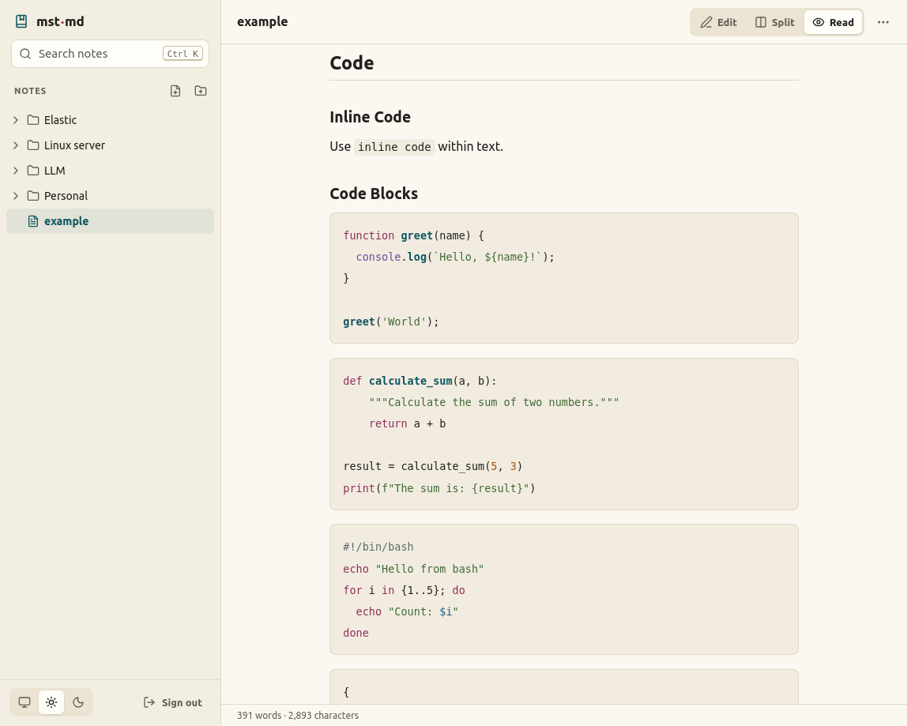
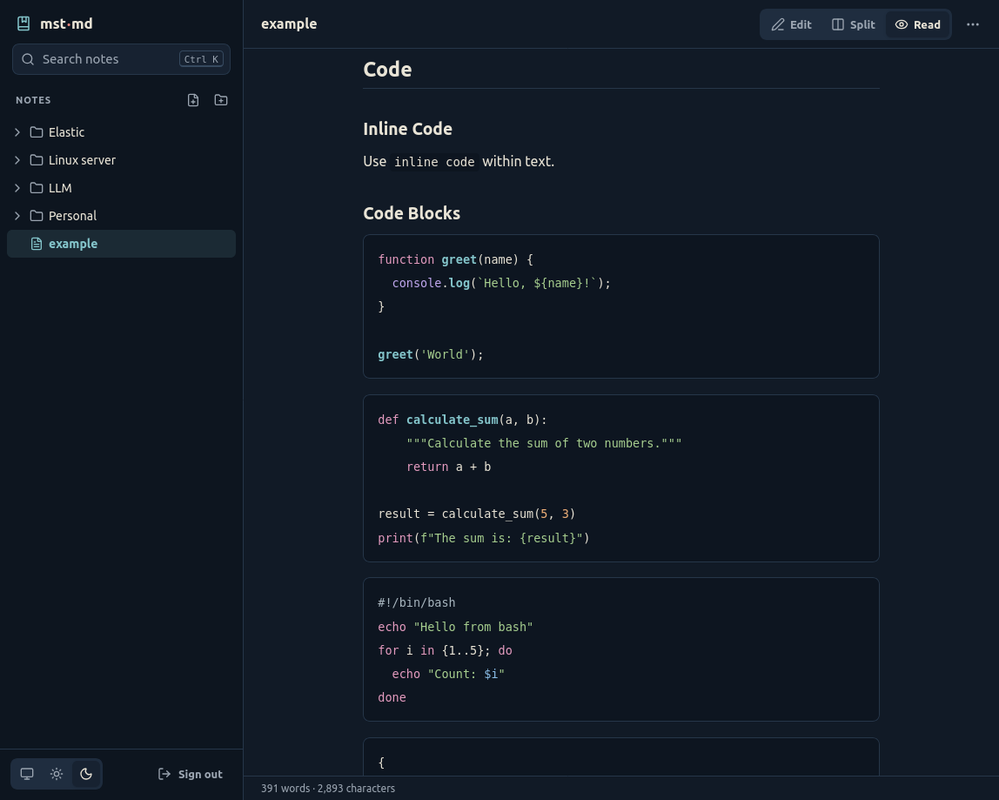
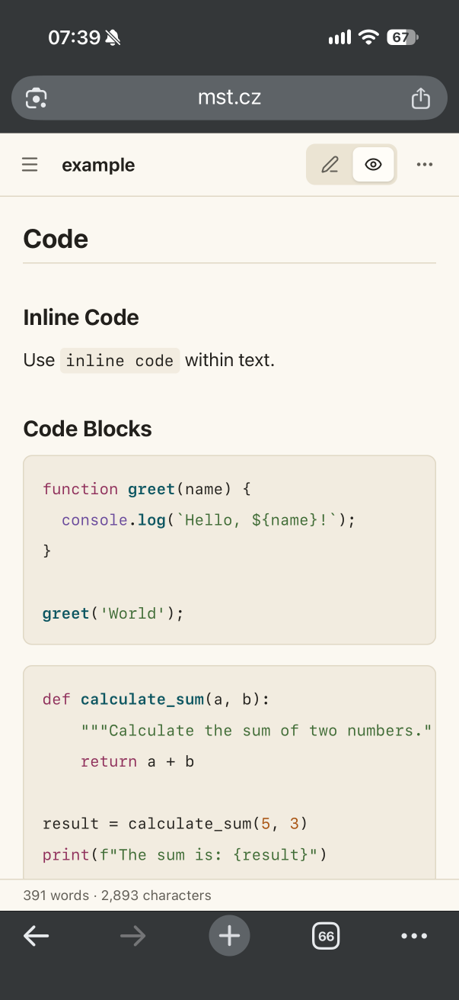
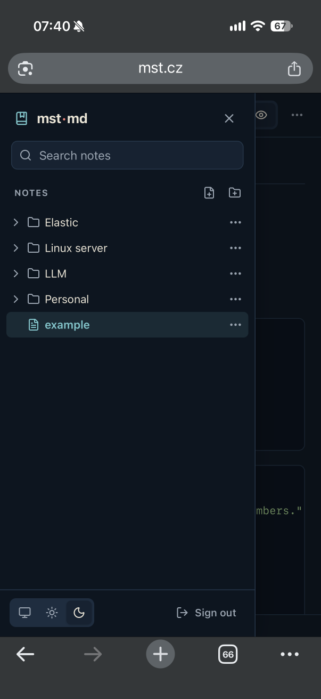

# mst·md

A small, private Markdown notebook for your own server. Notes are plain `.md`
files in a folder — no database, no build step, no third-party requests.

## Screenshots

| Light | Dark |
|---|---|
|  |  |

| Mobile light | Mobile dark |
|---|---|
|  |  |

## Features

- **Write** in a focused Markdown editor with live preview — *Edit*, *Split*
  (side by side or stacked, resizable) or *Read* view
- **Autosave** after a short pause, on tab switch and with <kbd>Ctrl</kbd>+<kbd>S</kbd>;
  unsaved edits are kept as a local draft if you go offline or your session expires
- **Conflict detection** — if a note changed in another tab or device, you choose
  whether to overwrite it or reload it, nothing is silently lost
- **Folders** — create notes and folders anywhere, rename, move, delete
- **Search** across all notes (names and content, Unicode-aware) with
  highlighted matches; <kbd>Ctrl</kbd>+<kbd>K</kbd>
- **Links between notes** — `[see](../other.md)` opens the other note
- **Deep links** — every note has its own URL (`…/#/folder/note.md`)
- GitHub-flavoured Markdown, task lists, tables, syntax-highlighted code
- Light / dark / system theme, works on phones (drawer sidebar, edit/read toggle)
- Keyboard friendly: arrow keys in the tree, <kbd>F2</kbd> for item actions,
  <kbd>Tab</kbd> indents, <kbd>Enter</kbd> continues lists, <kbd>Ctrl</kbd>+<kbd>B</kbd>/<kbd>I</kbd>

### Shortcuts

| Keys | Action |
|---|---|
| <kbd>Ctrl</kbd> <kbd>S</kbd> | Save now |
| <kbd>Ctrl</kbd> <kbd>K</kbd> | Search |
| <kbd>Alt</kbd> <kbd>N</kbd> | New note |
| <kbd>Ctrl</kbd> <kbd>Alt</kbd> <kbd>1</kbd> / <kbd>2</kbd> / <kbd>3</kbd> | Edit / Split / Read |
| <kbd>Tab</kbd> / <kbd>Shift</kbd> <kbd>Tab</kbd> | Indent / outdent |
| <kbd>Ctrl</kbd> <kbd>B</kbd> / <kbd>Ctrl</kbd> <kbd>I</kbd> | Bold / italic |

## Requirements

- PHP **8.1+** with `mbstring` (sessions and JSON are built in)
- nginx + PHP-FPM, or Apache with `mod_php`/FPM
- A modern browser (2024+: native `<dialog>`, popover, CSS `light-dark()`)

## Installation

```bash
git clone https://github.com/idahomst/mst-md.git /var/www/md
cd /var/www/md
cp config.example.php config.php
php -r "echo password_hash('your-password', PASSWORD_DEFAULT), PHP_EOL;"   # paste into config.php
mkdir -p notes data
chown -R www-data:www-data notes data      # the web server must be able to write here
chmod 750 notes data
```

Then open `https://your-server/md/` and sign in.

`config.php` is git-ignored. **Never commit it** — it contains your password hash.

### Keep notes outside the web root (recommended)

```php
// config.php
define('NOTES_DIR', '/srv/mst-md/notes');
define('DATA_DIR',  '/srv/mst-md/data');
```

## Deployment

The `notes/`, `data/`, `lib/` and `views/` folders must **not** be served
directly — otherwise anyone who guesses a file name can read your notes.

**Apache:** the bundled `.htaccess` files take care of it (`AllowOverride All`).

**nginx:** add to the server block, **above** your `location ~ \.php$` block (regex locations match in order; adjust `/md/` to your path):

```nginx
location ~ ^/md/(notes|data|lib|views)/ { deny all; return 404; }
location ~ ^/md/(config(\.example)?\.php|README\.md|LICENSE)$ { deny all; return 404; }
location ~ /\. { deny all; return 404; }
location ~* ^/md/assets/.+\.(css|js|svg)$ { expires 1y; add_header Cache-Control "public, immutable"; }
```

Asset URLs carry a version parameter, so long caching is safe.

Use **HTTPS**. Behind a TLS-terminating proxy, make sure it sends
`X-Forwarded-Proto: https` so the session cookie is marked `Secure`.

## Security

- Passwords are checked with `password_verify`; failed sign-ins are throttled
  **per IP** (5 per 15 minutes by default, stored in `data/`)
- Session cookie: `HttpOnly`, `SameSite=Strict`, `Secure` + `__Host-` prefix on HTTPS;
  session ID regenerated on sign-in; idle timeout (7 days by default)
- CSRF token on every state-changing request, including sign-in and sign-out
- Strict Content-Security-Policy (no inline scripts except a nonce'd theme
  snippet, no third-party origins), `X-Frame-Options: DENY`, `nosniff`, no referrer
- Rendered Markdown is sanitised with DOMPurify (no scripts, event handlers or forms)
- Paths are validated segment by segment: no `..`, no dotfiles, no symlinks,
  and only `.md` files can be read or written
- Writes are atomic (temp file + rename)

## Project layout

```
index.php            sign-in / sign-out / app shell
api.php              JSON API (GET reads, POST writes)
lib/bootstrap.php    config, session, security headers, auth helpers
lib/Notes.php        file-system repository (all path checks live here)
lib/RateLimiter.php  sign-in throttling
views/               login + app HTML
assets/app.css       styles (Japanese palette: kinari, sumi, ai, shu)
assets/js/           ES modules: main, api, ui, tree, markdown
assets/vendor/       marked, DOMPurify, highlight.js (self-hosted, see README there)
assets/icons.svg     Lucide icon sprite
notes/               your notes (git-ignored except the example)
data/                runtime data (git-ignored)
```

## License

MIT — see [LICENSE](LICENSE). Bundled libraries keep their own licenses
(see `assets/vendor/README.md`).
